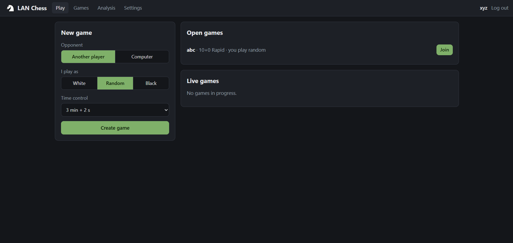
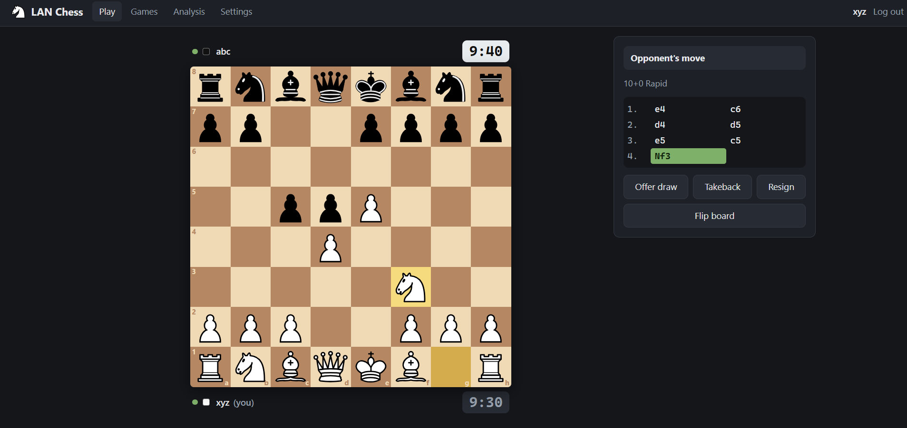
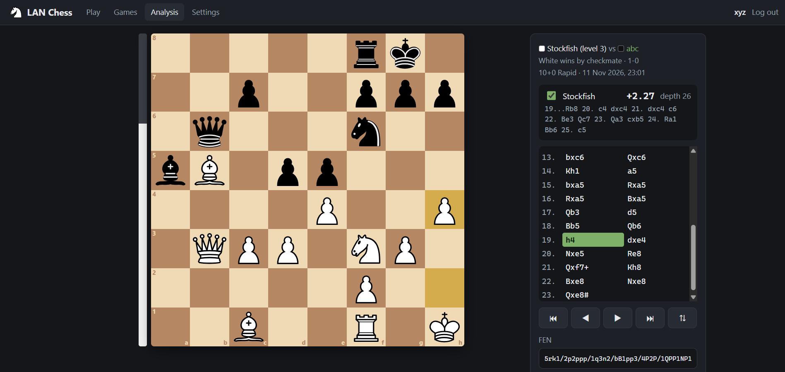
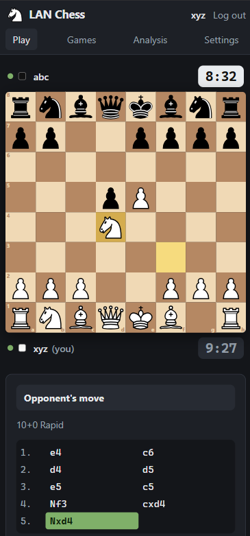
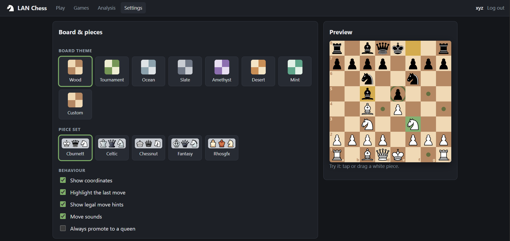
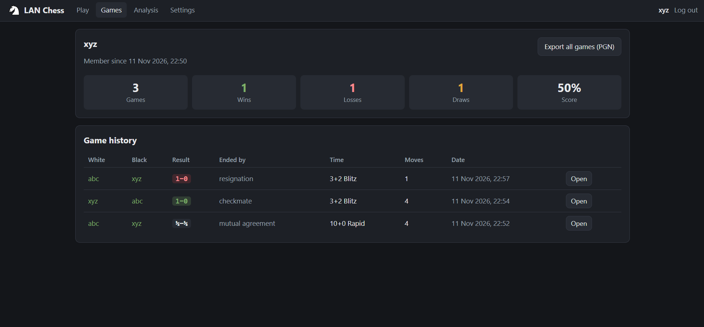
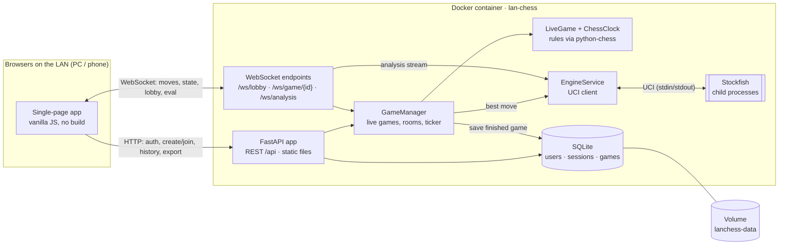

# ♞ LAN Chess

A self-hosted chess server for your local network. Run one Docker container on
any machine, and everyone on the same Wi-Fi/LAN can play, watch and analyse
games from a PC or phone browser — **no internet connection, no accounts on
someone else's service, no app to install.**

[](../../actions/workflows/ci.yml)


## Features

- **Real-time multiplayer** over WebSockets with a live lobby of open and running games
- **Spectators**: anyone on the LAN can watch a live game (board, moves, clocks), even without an account
- **Server-authoritative rules and clocks** — every move is validated by the server; the browser only renders
- **Time controls**: bullet / blitz / rapid / classical presets, custom time + Fischer increment, or no clock
- **Game actions**: resign, draw offers, takeback requests, rematch (colours swap)
- **Correct endings**: checkmate, stalemate, threefold repetition, fifty-move rule, insufficient material, timeout, resignation, agreement
- **Play vs computer**: Stockfish runs inside the container, 8 difficulty levels
- **Reconnect-safe**: refresh the page or lose Wi-Fi for a moment and you are back in the same game
- **Game archive**: every finished game is saved; browse your own and all public games
- **Export**: PGN (with standard tags and clock times), JSON, FEN of any position, bulk PGN of all your games
- **Analysis board**: step through any game, explore side lines without touching the saved game, live Stockfish eval bar and best line
- **Customisation**: 7 board themes + custom colours, 5 piece sets, coordinates, last-move highlight, move hints, sounds, auto-queen — saved per account and applied on every device
- **Touch-friendly**: tap-to-move and drag-and-drop on desktop and mobile
- **Fully offline**: no CDN, no external API; all assets and the engine are in the image

## Screenshots

> Placeholders — add your own images to [`docs/screenshots/`](docs/screenshots/) with these names.

| Lobby | Live game | Analysis board |
| ----- | --------- | -------------- |
|  |  |  |

| Mobile | Settings | Profile |
| ------ | -------- | ------- |
|  |  |  |

<!-- Optional:  -->

## Quick start (Docker)

```bash
git clone https://github.com/<your-user>/lan-chess.git
cd lan-chess
cp .env.example .env          # then edit ADMIN_PASSWORD (optional)
docker compose up -d
```

Open <http://localhost:8080> on the server, or `http://<server-ip>:8080` from any
other device on the network. Create an account and play.

> The first build needs internet access (base image, Python packages,
> Stockfish). After that the server runs entirely offline.

## Tech stack

| Layer | Choice | Why |
| ----- | ------ | --- |
| Backend | **Python 3.13 + FastAPI + Uvicorn** | First-class async WebSockets and REST in one small process; typed, readable, auto-generated API docs at `/api/docs`. |
| Chess rules | **python-chess** | Battle-tested move generation, draw detection, SAN/PGN and a UCI engine client — nothing chess-specific is hand-written. |
| Database | **SQLite** (standard library `sqlite3`, WAL mode) | Embedded: no extra container, a single file to back up, far more capacity than a LAN needs. |
| Engine | **Stockfish** (native binary, UCI over stdin/stdout) | Much stronger and lighter than WASM in every browser, works on old phones, and keeps the GPL engine a separate program. |
| Frontend | **Vanilla JavaScript (ES modules) + CSS**, no build step | Nothing to bundle or download at runtime, tiny payload, readable source. The board widget is ~250 lines. |
| Auth | scrypt password hashes, random session tokens in an HttpOnly cookie | Standard library only; tokens are stored hashed (HMAC) in the database and can be revoked. |
| Packaging | Multi-stage **Docker** image, one service in Compose | `docker compose up -d` is the whole deployment. |

One process holds all live games in memory, which makes real-time fan-out
trivial and fast; SQLite persists what must survive (accounts, preferences,
finished games).

## Architecture



**Data flow of a move:** the browser sends `{"type":"move","uci":"e2e4"}` → the
manager checks the sender's seat → `LiveGame` checks the flag, validates the
move with python-chess, presses the clock and looks for an ending → the new
full state is broadcast to both players and all spectators → if the game ended
it is written to SQLite; if it is the engine's turn a Stockfish request is
scheduled.

A background ticker (4×/s) flags players whose time ran out, so a game ends on
time even if nobody sends anything.

### Assumptions and design decisions

- **Finished games are public.** "All public games" is implemented as "all finished games on this server"; there are no private games.
- **Threefold repetition and the fifty-move rule end the game automatically** (as on most online servers) rather than requiring a claim.
- **A timeout is a draw** if the opponent has no mating material (FIDE 6.9).
- **The clock starts when the game starts** (opponent joined), with White to move.
- **Live games are kept in memory.** They survive client disconnects and page reloads, but not a server restart; only finished games are persisted. See [limitations](#known-limitations).
- **Clocks keep running while a player is disconnected**; an absent player eventually loses on time.
- **One open game per host**, and an open game is cancelled when its host has been gone for 60 seconds.
- **Against the computer**, takebacks are always granted and draw offers always declined; a rematch starts immediately.
- **Guests** (not logged in) can browse, watch and analyse; hosting and joining need an account.
- **Fonts and sounds are not bundled files**: the UI uses the device's system fonts and synthesises move sounds with the Web Audio API — fully offline with nothing to license.
- **The session cookie** is `HttpOnly` + `SameSite=Lax`; it is not marked `Secure` because a LAN server is plain HTTP.

### WebSocket protocol

All messages are JSON objects with a `type`. The session cookie authenticates
the socket. Clients may send `{"type":"ping"}` on any socket (answered with `pong`).

**`/ws/lobby`** — server → client only

| Message | Payload |
| ------- | ------- |
| `lobby` | `open: [{id, host, host_id, your_color, time_control, created_at}]`, `live: [{id, white, black, vs_computer, time_control, started_at}]` — a full snapshot, sent on connect and on every change |

**`/ws/game/{id}`** — client → server

| Message | Meaning |
| ------- | ------- |
| `move` `{uci}` | Play a move, e.g. `e2e4`, `e7e8q` |
| `resign` | Resign |
| `draw_offer` · `draw_accept` · `draw_decline` | Draw negotiation |
| `takeback_request` · `takeback_accept` · `takeback_decline` | Takeback negotiation |
| `rematch_offer` · `rematch_decline` | After the game; a second `rematch_offer` from the opponent accepts |
| `abort` | Host cancels a game nobody has joined yet |

**`/ws/game/{id}`** — server → client

| Message | Payload |
| ------- | ------- |
| `state` | The complete game, sent on connect and after every change: `status` (`open`/`live`/`finished`/`aborted`), `white`/`black` `{id, name, is_engine, connected}`, `fen`, `turn`, `moves [{san, uci}]`, `last_move`, `check`, `dests {from: [to]}` (legal moves), `clock {white, black, running}` in ms, `draw_offer`, `takeback_request`, `result`, `termination`, `winner`, `rematch {offered_by, game_id}`, `time_control`, `spectators`, and per receiver `you` (`white`/`black`/`null`) and `is_host` |
| `error` `{message}` | The last action was rejected (illegal move, not your turn, …) |
| `gone` | No such live game — the client loads the saved game instead |

Because every `state` is complete, reconnecting needs no special handling: the
client opens the socket again and renders what it receives. Clients tick the
clock locally between states; the server's numbers always win.

**`/ws/analysis`**

| Direction | Message | Payload |
| --------- | ------- | ------- |
| → server | `analyse` `{fen}` | Start analysing a position (cancels the previous one) |
| → server | `stop` | Stop analysing |
| → client | `info` | `fen`, `depth`, `cp` (centipawns, White's view) or `mate`, `best` (UCI), `line` (SAN) |
| → client | `unavailable` | Engine missing or all analysis slots busy |

### REST API (summary)

Interactive documentation is served at `/api/docs`.

| Method & path | Purpose |
| ------------- | ------- |
| `POST /api/auth/register` · `login` · `logout` | Accounts |
| `GET /api/me` · `PUT /api/me/prefs` | Current user and preferences |
| `GET /api/config` · `GET /api/health` | Server info, health check |
| `POST /api/games` · `POST /api/games/{id}/join` | Host / join |
| `GET /api/games?player=&page=` · `GET /api/games/{id}` | Archive |
| `GET /api/games/{id}/pgn` · `/json` · `/fen?ply=N` | Export |
| `GET /api/users/{name}` · `/api/users/{name}/games.pgn` | Profile, bulk PGN |
| `POST /api/position` | Validate a position / move for the analysis board |
| `DELETE /api/games/{id}` | Admin: delete a saved game or abort a live one |

### Database schema

Defined in [`app/db.py`](app/db.py):

| Table | Columns |
| ----- | ------- |
| `users` | `id`, `username` (unique, case-insensitive), `password_hash`, `is_admin`, `prefs` (JSON), `created_at` |
| `sessions` | `token_hash` (PK), `user_id` → users, `created_at`, `expires_at` |
| `games` | `id`, `white_id`/`black_id` → users (NULL = engine), `white_name`, `black_name`, `vs_computer`, `engine_level`, `base_seconds`, `increment_seconds`, `result`, `termination`, `moves` (JSON `[{uci, san, white_ms, black_ms}]`), `ply_count`, `started_at`, `ended_at` |

## LAN access guide

### 1. Find the server's IP address

| OS | Command | Look for |
| -- | ------- | -------- |
| Windows | `ipconfig` | "IPv4 Address" of your Wi-Fi/Ethernet adapter |
| Linux | `hostname -I` or `ip -4 addr` | e.g. `192.168.x.x` / `10.x.x.x` |
| macOS | `ipconfig getifaddr en0` (Wi-Fi) | or System Settings → Network |

Tip: give the server a fixed address (DHCP reservation in your router) so the URL never changes.

### 2. Open the port in the firewall

- **Windows** (PowerShell as Administrator):
  ```powershell
  New-NetFirewallRule -DisplayName "LAN Chess" -Direction Inbound -Protocol TCP -LocalPort 8080 -Action Allow -Profile Private
  ```
  Make sure the network is set to *Private*, not *Public*.
- **Linux (ufw):** `sudo ufw allow 8080/tcp`
- **Linux (firewalld):** `sudo firewall-cmd --permanent --add-port=8080/tcp && sudo firewall-cmd --reload`
- **macOS:** System Settings → Network → Firewall: allow incoming connections for Docker.

### 3. Connect from a phone or another PC

Join the same Wi-Fi/network and open `http://<server-ip>:8080` in the browser
(type `http://` explicitly — there is no HTTPS). On a phone, "Add to Home
screen" gives you an app-like shortcut.

Not reachable? Check that the device is not on a *guest* Wi-Fi (those isolate
clients), that `docker compose ps` shows the container as `healthy`, and that
`HOST_BIND` in `.env` is `0.0.0.0`.

## Installing Docker

**Linux** (Debian/Ubuntu and most distributions):

```bash
curl -fsSL https://get.docker.com | sudo sh
sudo usermod -aG docker "$USER"     # log out and back in afterwards
docker compose version              # the Compose plugin is included
```

**Windows 10/11:**

1. Enable WSL 2: open PowerShell as Administrator, run `wsl --install`, reboot.
2. Install [Docker Desktop](https://www.docker.com/products/docker-desktop/) and keep "Use WSL 2 based engine" enabled.
3. Start Docker Desktop, then run the quick-start commands in PowerShell or a WSL terminal.

Docker Desktop publishes container ports on the Windows host, so other devices
reach the app at the **Windows machine's** IP once the firewall rule above exists.

**macOS:** install [Docker Desktop](https://www.docker.com/products/docker-desktop/) or `brew install --cask docker`.

## Operating the server

```bash
docker compose up -d            # start (builds on first run)
docker compose ps               # status and health
docker compose logs -f          # follow the logs
docker compose stop             # stop, keep everything
docker compose down             # stop and remove the container (data volume is kept)

# update to a newer version
git pull
docker compose up -d --build
```

Configuration lives in `.env` (see [`.env.example`](.env.example) for every
option); run `docker compose up -d` again after changing it.

### Backup and restore

All state (database and generated secret key) is in the named volume `lanchess-data`.

```bash
# backup -> ./lanchess-backup.tar.gz  (works offline: it reuses the app image)
docker run --rm --user root --entrypoint tar \
  -v lanchess-data:/data:ro -v "$(pwd)":/backup \
  lan-chess:latest czf /backup/lanchess-backup.tar.gz -C /data .

# restore (stop the server first)
docker compose down
docker run --rm --user root --entrypoint sh \
  -v lanchess-data:/data -v "$(pwd)":/backup \
  lan-chess:latest -c "rm -rf /data/* && tar xzf /backup/lanchess-backup.tar.gz -C /data"
docker compose up -d
```

On Windows PowerShell replace `$(pwd)` with `${PWD}`.

Prefer a plain folder? Replace the volume line in `docker-compose.yml` with
`- ./data:/data` and make the folder writable for the container user
(`sudo chown 10001 data`). `./data` is git-ignored.

## Running without Docker

Requirements: Python 3.11+ and, for the computer opponent and analysis, a
Stockfish binary on the `PATH` (`sudo apt install stockfish`,
`brew install stockfish`, or download from <https://stockfishchess.org/download/>
and set `STOCKFISH_PATH` in `.env`).

```bash
cp .env.example .env
./scripts/start.sh              # Linux / macOS / WSL
```

```powershell
Copy-Item .env.example .env
.\scripts\start.ps1             # Windows PowerShell
```

The script creates `.venv`, installs the dependencies, loads `.env` and starts
the server on `APP_HOST:APP_PORT` (default `0.0.0.0:8080`). Data is stored in `./data`.

Manual steps, if you prefer:

```bash
python3 -m venv .venv && . .venv/bin/activate
pip install -r requirements.txt
python -m app
```

## Running tests

```bash
python3 -m venv .venv && . .venv/bin/activate
pip install -r requirements-dev.txt

pytest                 # test suite
ruff check .           # lint
ruff format --check .  # formatting
```

| File | Covers |
| ---- | ------ |
| `tests/test_clock.py` | Countdown, increment, flag fall, freeze, no-clock mode |
| `tests/test_game.py` | Move validation, castling, en passant, promotion, every automatic ending, timeouts |
| `tests/test_actions.py` | Resignation, draw offers, takebacks (1 and 2 plies, clock restore), rematch offers |
| `tests/test_pgn.py` | PGN tags, round trip, clock comments, bulk export, JSON/FEN |
| `tests/test_api.py` | Accounts, preferences, lobby, full games over WebSockets, reconnects, exports, admin, engine |

Engine tests are skipped automatically when Stockfish is not installed. The
same checks plus a Docker build-and-start smoke test run in
[GitHub Actions](.github/workflows/ci.yml) on every push and pull request.

## Project structure

```text
lan-chess/
├── app/                      # Backend (Python)
│   ├── __main__.py           #   `python -m app` entry point
│   ├── main.py               #   app factory, lifespan, static files
│   ├── config.py             #   settings from environment variables
│   ├── db.py                 #   SQLite schema + repository
│   ├── security.py           #   password hashing, session tokens
│   ├── auth.py               #   account endpoints, auth dependencies
│   ├── schemas.py            #   request models, preferences model
│   ├── clock.py              #   server-authoritative chess clock
│   ├── game.py               #   LiveGame: rules, offers, takebacks, endings
│   ├── manager.py            #   live games, rooms, ticker, engine turns, saving
│   ├── engine.py             #   Stockfish (UCI) for play and analysis
│   ├── pgn.py                #   PGN / JSON / FEN export
│   ├── routes.py             #   REST endpoints
│   └── ws.py                 #   WebSocket endpoints
├── web/                      # Frontend (served as static files, no build)
│   ├── index.html
│   ├── css/app.css
│   ├── js/
│   │   ├── main.js           #   bootstrap + router
│   │   ├── api.js            #   fetch wrapper, reconnecting WebSocket
│   │   ├── state.js          #   session, preferences, themes
│   │   ├── board.js          #   chessboard widget (tap + drag)
│   │   ├── sound.js          #   synthesised move sounds
│   │   ├── util.js
│   │   └── views/            #   lobby, game, analysis, games, profile, settings, auth
│   └── pieces/               #   bundled SVG piece sets
├── tests/                    # pytest suite
├── scripts/                  # start.sh / start.ps1 (run without Docker)
├── docs/screenshots/         # images for this README
├── .github/workflows/ci.yml  # lint, tests, Docker build
├── Dockerfile
├── docker-compose.yml
├── .env.example
├── requirements.txt / requirements-dev.txt
├── pyproject.toml            # Ruff and pytest configuration
├── LICENSE
└── THIRD_PARTY_NOTICES.md
```

## Known limitations

- **Games in progress are lost if the server restarts** — live state is in memory; only finished games are stored.
- **Single process by design.** Live games are not shared between workers, so the app must run as one Uvicorn process (plenty for a LAN, not a design for thousands of users).
- **Plain HTTP.** Fine on a trusted home/office network; do not expose the port to the internet without a TLS reverse proxy.
- **No ratings, chat, tournaments, premoves or move animations.**
- **Analysis explores one side line at a time** (not a full variation tree) and is limited to `MAX_ANALYSIS_ENGINES` simultaneous engines.
- **No password reset flow**; forgotten passwords need a new account (the admin password can be reset through `.env`).
- Standard chess only (no Chess960 or other variants).

## Possible improvements

- Persist live games so they resume after a restart
- Elo/Glicko ratings and a leaderboard
- In-game chat and emoji reactions
- Premoves, piece animations, captured-material display
- Full variation tree, PGN import and annotations on the analysis board
- Correspondence (days per move) games and simple tournaments
- Optional HTTPS via a bundled Caddy service
- Installable PWA with a service worker
- Admin panel for user management

## License

The code in this repository is released under the [MIT License](LICENSE).
Bundled piece sets and the software installed into the Docker image (notably
Stockfish and python-chess, both GPLv3) have their own licences — see
[THIRD_PARTY_NOTICES.md](THIRD_PARTY_NOTICES.md) for details and what they mean
if you redistribute a built image.
